# django-admin-tables

[](https://github.com/rodolvbg/django-admin-tables/actions/workflows/pytest.yml)
[](https://github.com/rodolvbg/django-admin-tables/actions/workflows/js-tests.yml)
[](https://pypi.org/project/django-admin-tables/)
[](https://pypi.org/project/django-admin-tables/)
[](https://pypi.org/project/django-admin-tables/)
[](https://pepy.tech/project/django-admin-tables)

Extras for the Django admin's tables — changelists and inlines — in one
mixin, for Django's own admin and [django-unfold](docs/themes/unfold.md):

- **[Exclusive radio fields](#exclusive-radio-fields)** — a `BooleanField`
  column where only one row can be true, shown as radio buttons.
- **[Foreign key links](#foreign-key-links)** — foreign keys in
  `list_display` as links to their change view.
- **[Hideable columns](#hideable-columns)** — a "Columns" menu on the
  changelist to hide or show columns, remembered per user.
- **[Responsive columns](#responsive-columns)** — columns hidden on
  narrow screens, on the changelist and in tabular inlines.
- **[Footer rows](#footer-rows)** — totals, averages… below the columns,
  on the changelist and in inlines.
- **[Row actions](#row-actions)** — buttons on each row ("Feature",
  "Delete"…), on the changelist and in inlines.
- **[Selectable rows](#selectable-rows)** — which rows of the changelist
  can be selected for an action, object by object.
- **[Search suggestions](#search-suggestions)** — the changelist's search
  box suggests objects as one types; choosing one opens it.
- **[Autosave](#autosave)** — `list_editable` fields that save themselves
  as they change, without the "Save" button.
- **[Unsaved changes](#unsaved-changes)** — the changelist asks before
  losing `list_editable` edits.

## Install

```bash
uv add django-admin-tables
# or
pip install django-admin-tables
```

Add it to `INSTALLED_APPS` (so Django finds its templates, and
`django.contrib.staticfiles` its JS and CSS):

```python
INSTALLED_APPS = [
    ...,
    "django_admin_tables",
]
```

## One mixin

`AdminTablesMixin` brings every extra, on a `ModelAdmin`, a `TabularInline`
or a `StackedInline`. Each one is off until you set its option:

```python
from django.contrib import admin
from django.db.models import Count
from django_admin_tables import AdminTablesMixin


@admin.register(Image)
class ImageAdmin(AdminTablesMixin, admin.ModelAdmin):
    list_display = ("title", "album", "is_primary")
    list_editable = ("is_primary",)
    list_display_foreign_key_links = ("album",)  # foreign key links
    list_display_hideable = ("album",)  # hideable columns
    responsive_columns = {"album": "md"}  # responsive columns
    footer_rows = [("Total", {"title": Count("pk")})]  # footer rows
    row_actions = ["view", "delete"]  # row actions
    radio_select_exclusive_fields = ("is_primary",)  # exclusive radio fields


class ImageInline(AdminTablesMixin, admin.TabularInline):
    model = Image
    radio_select_exclusive_fields = ("is_primary",)
    responsive_columns = {"is_featured": "md"}
```

Foreign key links and hideable columns only apply to a `ModelAdmin`'s
changelist (an inline has no `list_display`). Each extra's mixin is
available on its own too: `ExclusiveRadioFieldsMixin`,
`ForeignKeyLinkMixin`, `HideableColumnsMixin` (hideable and responsive
columns), `FooterRowsMixin`, `RowActionsMixin`, `SelectableRowsMixin`,
`SearchSuggestionsMixin`, `ListEditableAutosaveMixin` and
`UnsavedChangesMixin`.

## Exclusive radio fields

An inline `BooleanField` column renders as independent checkboxes:

```text
Image A    [ ]
Image B    [x]
Image C    [ ]
```

Nothing stops you from checking more than one — but often only one row
should ever be true (the primary image, the default address, the featured
item). `AdminTablesMixin` renders that column as radio buttons
instead:

```text
Image A    ( )
Image B    (•)
Image C    ( )
```

Selecting one clears the others, with a small vanilla JS module. Every row
still POSTs under its own Django-generated field name (`images-0-is_primary`,
`images-1-is_primary`…), and a formset-level check on the server rejects a
handcrafted POST setting more than one row true, so the guarantee doesn't
depend on JavaScript running.

Inline formset, before and after clicking a different row's radio — note
`is_primary` switches from "Snowy Peak" to "Frozen Lake" while the
independent `is_featured` column ("Cabin") is untouched:

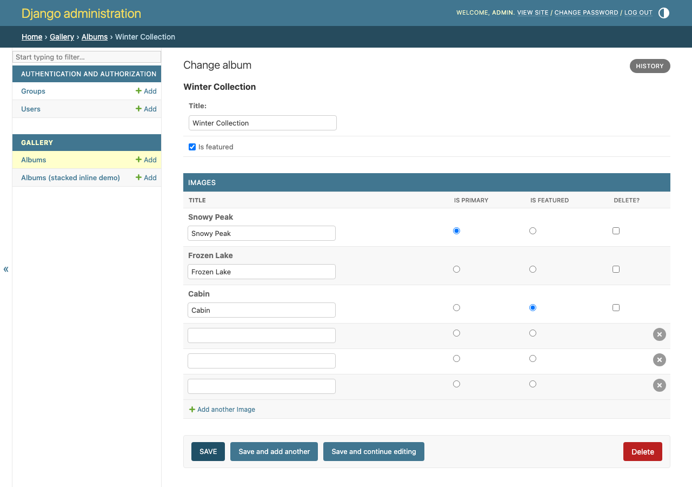
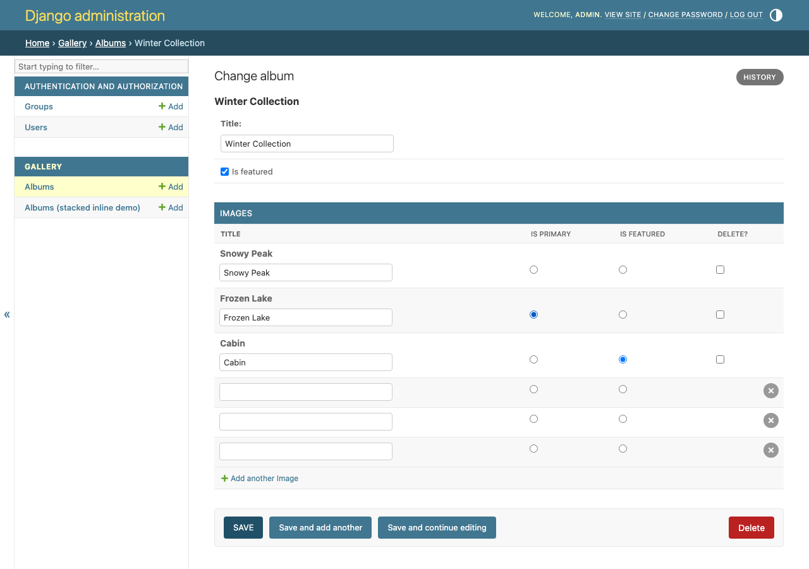

```python
from django.contrib import admin
from django_admin_tables import AdminTablesMixin

from .models import Album, Image


class ImageInline(AdminTablesMixin, admin.TabularInline):
    model = Image
    radio_select_exclusive_fields = ("is_primary",)


@admin.register(Album)
class AlbumAdmin(admin.ModelAdmin):
    inlines = [ImageInline]
```

It works the same way with `StackedInline`, and several fields are
independent groups:

```python
class ImageInline(AdminTablesMixin, admin.StackedInline):
    model = Image
    radio_select_exclusive_fields = ("is_primary", "is_featured")
```

Compute the field list per request (and, for an inline or a change form,
per object) instead of the class attribute:

```python
class ImageInline(AdminTablesMixin, admin.TabularInline):
    model = Image

    def get_radio_select_exclusive_fields(self, request, obj=None):
        return ("is_primary",) if request.user.is_superuser else ()
```

Whatever `get_radio_select_exclusive_fields` returns is filtered against
`get_readonly_fields(request, obj)`: a readonly field isn't an editable
widget, so there's nothing to turn into a radio button — which matters for
a field that's only readonly for some requests.

Each configured name must be a `BooleanField` present on the **form** —
anything else raises `ImproperlyConfigured` when the admin builds the
formset. Only the form is inspected: a field declared on a custom form
(not on the model), or a form field overriding the model field's type,
works the same.

### On the changelist (`list_editable`)

The same mixin works on a `ModelAdmin`, for a `BooleanField` column made
editable in the changelist with `list_editable` (the field must be in
`list_display` too, as Django requires):

```python
@admin.register(Album)
class AlbumAdmin(AdminTablesMixin, admin.ModelAdmin):
    list_display = ("title", "is_featured")
    list_editable = ("is_featured",)
    radio_select_exclusive_fields = ("is_featured",)
```

Only one `Album` in the whole changelist can be featured at a time — same
client-side sync, same server-side check on save:

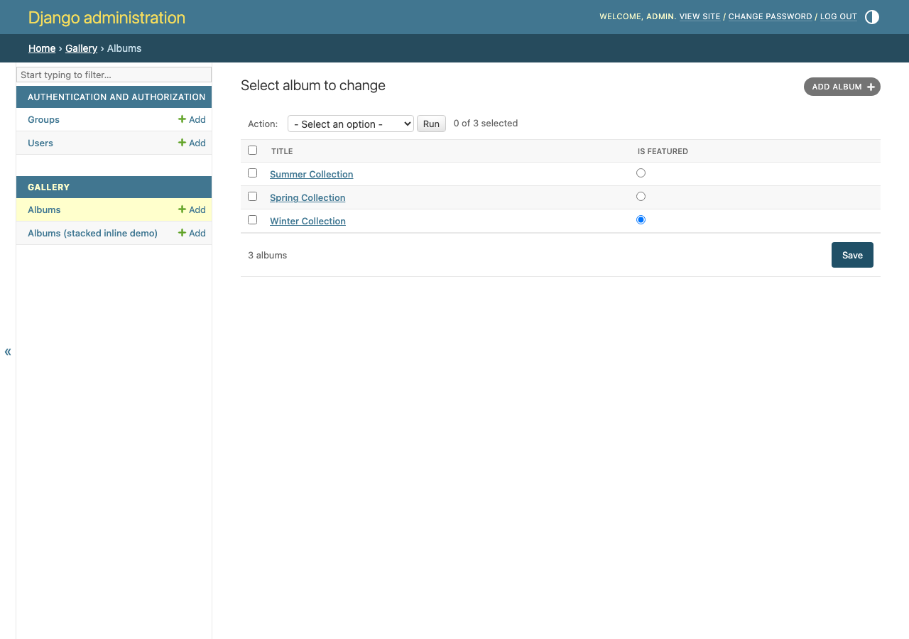

## Foreign key links

`AdminTablesMixin` turns the foreign keys you list into links to the
related object's change view:

```python
from django.contrib import admin
from django_admin_tables import AdminTablesMixin


@admin.register(Book)
class BookAdmin(AdminTablesMixin, admin.ModelAdmin):
    list_display = ("title", "author")
    list_display_foreign_key_links = ("author",)
```

**Before** — `author` as plain text:

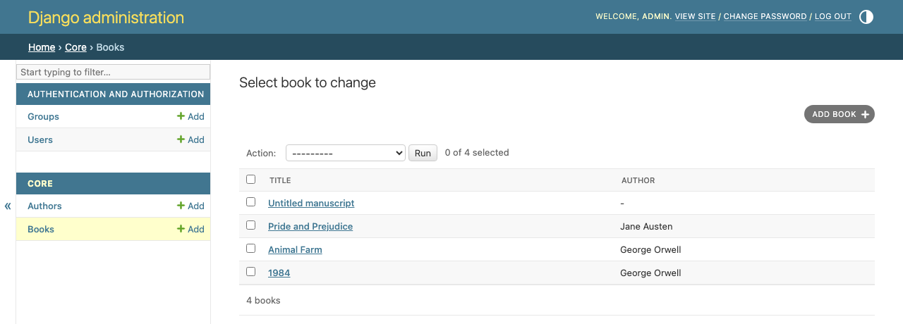

**After** — `author` as a link to its change view:

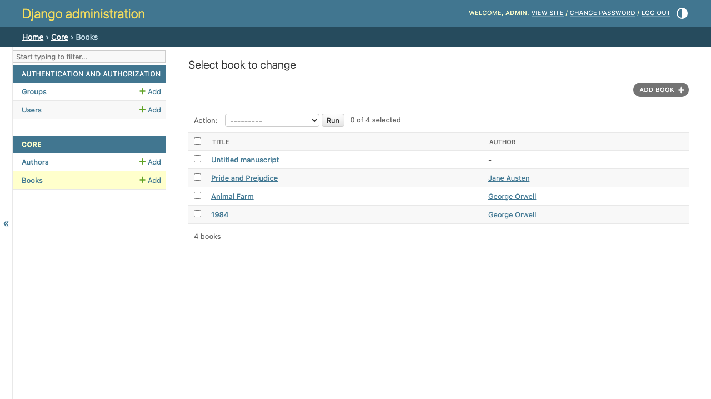

The listed fields keep their column's header and sorting, and the links
point at the change view of the `AdminSite` the `ModelAdmin` belongs to
(custom sites included). Override `get_list_display_foreign_key_links(request)`
to choose them per request.

### Customizing the link

Override `get_foreign_key_link()` to change the markup — return safe HTML
(`format_html()`), since the admin escapes plain strings:

```python
from django.utils.html import format_html


class BookAdmin(AdminTablesMixin, admin.ModelAdmin):
    list_display = ("title", "author")
    list_display_foreign_key_links = ("author",)

    def get_foreign_key_link(self, obj, field_name, related, url):
        return format_html('<a class="button" target="_blank" href="{}">{}</a>', url, related)
```

Or render it from a template, with `obj`, `related`, `url`, `field_name`
and `link_class` in its context:

```python
class BookAdmin(AdminTablesMixin, admin.ModelAdmin):
    list_display = ("title", "author")
    list_display_foreign_key_links = ("author",)
    foreign_key_link_template = "admin/book_author_link.html"
```

```django
{# templates/admin/book_author_link.html #}
<a class="fk-link" href="{{ url }}" title="{{ obj }}">{{ related }}</a>
```

To only add a CSS class, set `foreign_key_link_class = "my-link"`.

## Hideable columns

List the `list_display` entries the user can hide, and a "Columns" menu
appears on the changelist:

```python
@admin.register(Image)
class ImageAdmin(AdminTablesMixin, admin.ModelAdmin):
    list_display = ("title", "album", "is_primary", "is_featured")
    list_display_hideable = ("album", "is_primary", "is_featured")
    list_display_hidden = ("is_featured",)  # hidden until shown
```

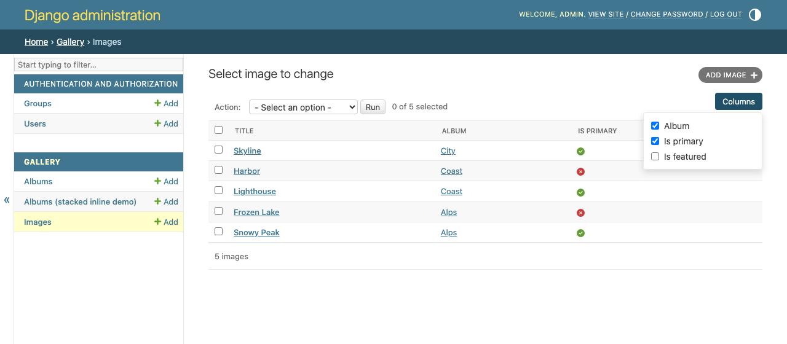

The choice is per user, per model and per browser, kept in its
`localStorage`: there's nothing to migrate or store on the server, and a
hidden column is still there for sorting, actions and `list_editable`.
`list_display_hidden` sets which columns start hidden, until the user
chooses. Override `get_list_display_hideable(request)` or
`get_list_display_hidden(request)` to choose them per request.

Entries are named as in `list_display`: a field, or a method's or
callable's name. A foreign key shown as a link keeps its field's name
(`"album"`).

The menu is added by rendering the changelist with
`django_admin_tables/change_list.html`, which extends the template the
admin would use — your `change_list_template` included — and adds the
menu to its `search` block (in Unfold's, its `filters` block). System
checks report a hideable entry that isn't in `list_display`
(`django_admin_tables.E001`) or a hidden one that isn't hideable
(`django_admin_tables.E002`).

## Responsive columns

Map columns to the viewport width under which they're hidden, on a
`ModelAdmin`'s changelist (`list_display` names) or a `TabularInline`
(field names):

```python
@admin.register(Image)
class ImageAdmin(AdminTablesMixin, admin.ModelAdmin):
    list_display = ("title", "album", "is_primary", "created")
    responsive_columns = {"album": "md", "created": "lg"}


class ImageInline(AdminTablesMixin, admin.TabularInline):
    model = Image
    responsive_columns = {"is_featured": "md"}
```

A width is a breakpoint's name — `"sm"` (640px), `"md"` (768px), `"lg"`
(1024px), `"xl"` (1280px), `"2xl"` (1536px), Tailwind's, which
django-unfold uses — or pixels (`{"created": 900}`): the column is hidden
when the viewport is narrower than that. They're CSS media queries: they
follow the window as it's resized or the phone turned.
Override `get_responsive_columns(request, obj=None)` to choose them per
request.

With the [Columns menu](#hideable-columns), a column the screen hides is
unchecked and disabled there, noted "(narrow screen)", and gets the user's
choice back on a wider screen:

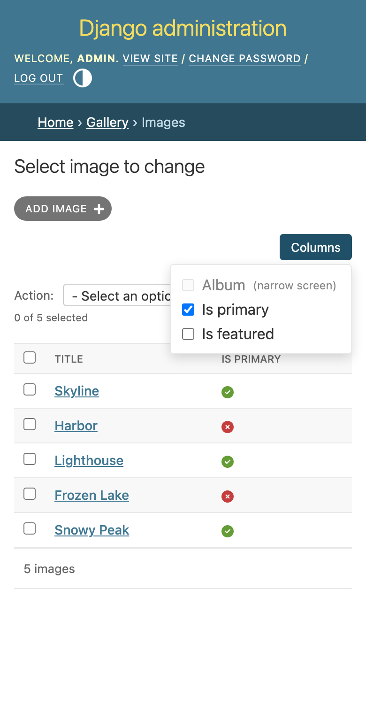

In an inline, a hidden column's field is still in the form, with its
value: hide columns that are optional or read-only, since a required one
can't be filled in on a narrow screen. The inline is rendered with
`django_admin_tables/edit_inline.html`, which adds the media queries and
includes the inline's own `template`. System checks report an unknown
width (`django_admin_tables.E003`) and, on a `ModelAdmin`, a column that
isn't in `list_display` (`django_admin_tables.E004`).

## Footer rows

Totals, averages or any other summary below the columns, on a
`ModelAdmin`'s changelist or in an inline:

```python
from django.db.models import Avg, Count, Sum


@admin.register(Order)
class OrderAdmin(AdminTablesMixin, admin.ModelAdmin):
    list_display = ("number", "customer", "amount", "tax")
    footer_rows = [
        ("Total", {"number": Count("pk"), "amount": Sum("amount"), "tax": Sum("tax")}),
        ("Average", {"amount": Avg("amount")}),
    ]


class OrderLineInline(AdminTablesMixin, admin.TabularInline):
    model = OrderLine
    footer_rows = [("Total", {"quantity": Sum("quantity"), "price": Sum("price")})]
```

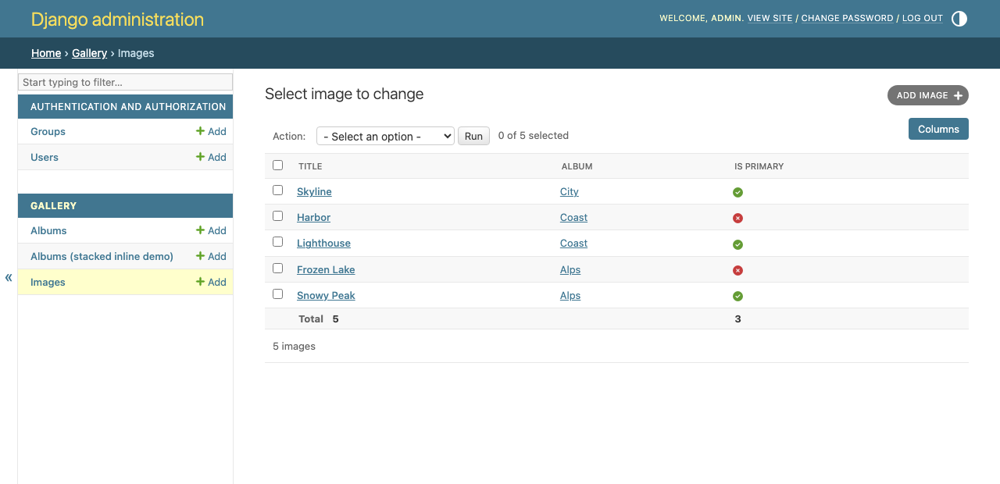

- Each row is a label and `{column: value}` (`list_display` names on the
  changelist, field names in an inline). A value is an **aggregate**
  (`Sum`, `Avg`, `Count`, `Max`…, `filter=` included), a
  **`callable(queryset)`** for anything else, or a constant. All the
  aggregates of all the rows run in **one query**.
- **What is added up** on the changelist — `footer_scope`:
  - `"filtered"` (default): every row matching the current filters and
    search, on **every page**: the total doesn't change from page to page.
  - `"page"`: only the rows shown.

  In an inline, the rows of the object being edited
  (`get_inline_footer_queryset()` to change it). With
  [django-admin-inline-controls](https://github.com/rodolvbg/django-admin-inline-controls)
  on the same inline, `"filtered"` is every row matching its filters, on
  every page, `"page"` the rows shown, and the totals come back with the
  refreshed inline. Neither package depends on the other.
- **Where they go — rendered by the server, no JS:** the table's own
  `<tfoot>`, each value under its column, hidden along with it (hideable
  and responsive columns); the label spans the columns before the first
  value. The admin's template is rendered as usual (Django's, a theme's or
  your own) and the `<tfoot>` is inserted before its `</table>`. On a
  stacked inline, or when a value's column isn't a column of the table,
  they're a summary line below it instead ("Total: Title 2").
- **In the add view**, an inline has no saved rows to add up: its `<tfoot>`
  has the labels and `data-*` attributes with empty values, for your own
  JS to fill in if you want.
- `get_footer_rows(request, obj=None)` chooses them per request (`obj` is
  the object an inline belongs to). `format_footer_value(column, value)`
  formats each value: the default rounds floats and decimals to 2 places
  (`1234.5`); return safe HTML for markup.

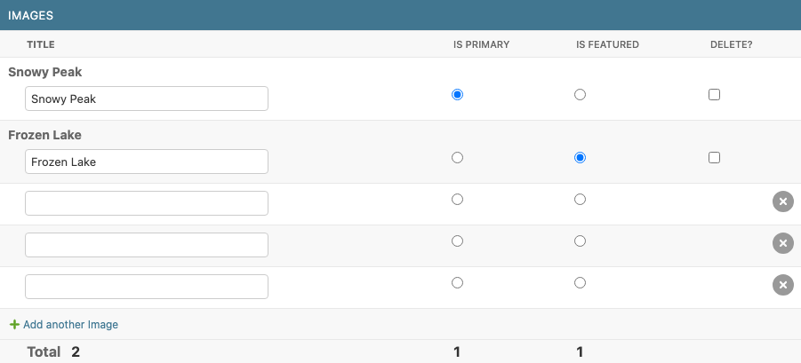

Each value carries `data-footer-row`, `data-column` and `data-value` (the
plain number, `"1234.5"`) for your JS. Override `footer_tfoot_template` or
`footer_summary_template` (extending `django_admin_tables/tfoot.html` /
`footer_summary.html`) to change the markup. System checks report a
`footer_scope` that isn't `"filtered"` or `"page"`
(`django_admin_tables.E005`), a row that isn't a `(label, {column: value})`
pair (`django_admin_tables.E006`) and, on a `ModelAdmin`, a column that
isn't in `list_display` (`django_admin_tables.E007`).

## Row actions

Buttons on each row, on a `ModelAdmin`'s changelist or in an inline:

```python
from django_admin_tables import AdminTablesMixin, row_action


@admin.register(Image)
class ImageAdmin(AdminTablesMixin, admin.ModelAdmin):
    list_display = ("title", "album", "row_actions")  # or last, by default
    row_actions = ["view", "toggle_featured", "delete"]

    @row_action(permissions=["change"])
    def toggle_featured(self, request, obj):
        obj.is_featured = not obj.is_featured
        obj.save()
        self.message_user(request, f"“{obj}” updated.")

    def get_toggle_featured_label(self, obj):
        return "Unfeature" if obj.is_featured else "Feature"


class ImageInline(AdminTablesMixin, admin.TabularInline):
    model = Image
    row_actions = ["toggle_featured", "delete"]
    ...
```

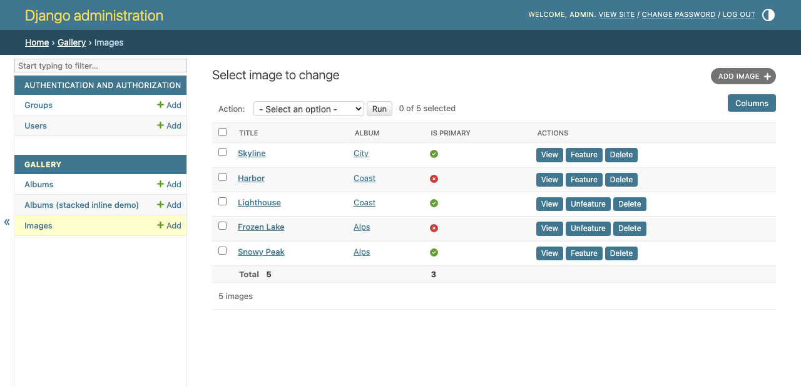

- An action is a method (listed by name) or a callable, taking **one
  row**, `(request, obj)` — on an inline it may take `parent_obj` too, the
  object being edited — or **a queryset** with only that row,
  `(request, queryset)`: the admin's own actions work as they are.
- **Built in:** `"view"`, a link to the row's change view, and `"delete"`,
  which asks first, deletes the row (its `delete()` and signals run) and
  records it in the history.
- `@row_action(permissions=[...], description="...", confirmation="...")`
  (or `@admin.action`) sets who may run it — checked for the row, or on an
  inline for the object being edited —, its label and a confirmation
  prompt; `%(object)s`, `%(verbose_name)s` can be used in both. Per row,
  `get_<action>_label(obj)`, `get_<action>_css(obj)` and
  `get_<action>_attrs(obj)` change them, and `get_row_actions(request, obj)`
  which actions a row gets. `@row_action(link=True)` with
  `get_<action>_url(obj)` makes a link of it.
- A button posts to the `ModelAdmin`'s `<pk>/row-action/<action>/` URL,
  which runs the action and comes back to the page — keeping its filters,
  search and page — with the messages it sent (`message_user()`). Return an
  `HttpResponse` instead for a file download or another page. With unsaved
  changes on the page, it asks before leaving them.
- On a changelist the buttons are the "Actions" column (`"row_actions"` in
  `list_display` places it). In an inline they're a read-only column of its
  saved rows, and post to the parent `ModelAdmin`, which needs the mixin
  too (`django_admin_tables.E009`).
- With [django-admin-inline-controls](https://github.com/rodolvbg/django-admin-inline-controls)
  on the inline, an action refreshes only the inline, in place, with its
  filters and page, and shows its messages. Neither package depends on the
  other.

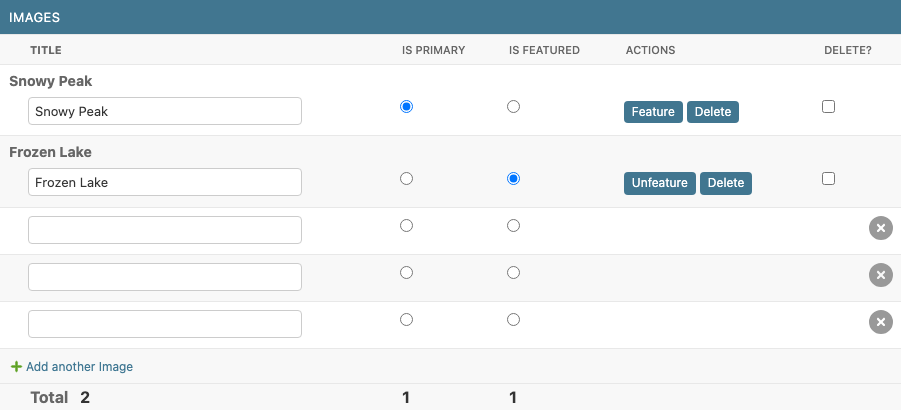

Override `row_actions_template` (extending
`django_admin_tables/row_actions.html`) to change the markup. System
checks report an action that isn't a method nor a built-in one
(`django_admin_tables.E008`).

## Selectable rows

Some objects shouldn't be acted on: an archived invoice, the album's
primary image. `is_row_selectable()` says which rows of the changelist can
be selected for an action:

```python
class ImageAdmin(AdminTablesMixin, admin.ModelAdmin):
    def is_row_selectable(self, request, obj):
        return not obj.is_primary

    def get_row_unselectable_reason(self, request, obj):  # optional
        return _("The album's primary image: choose another one first.")

    def filter_selectable_rows(self, request, queryset):  # optional, faster
        return queryset.filter(is_primary=False)
```

- The checkbox of a row that can't be selected is disabled, with the
  reason as its title (on hover, and read by screen readers). "Select
  all" leaves it out, and the counter only counts the others ("2 of 2
  selected").
- Actions never get those objects: not through "Select all 250 images",
  nor through a request made by hand. They're left out, with a warning
  ("1 image was left out: it can't be selected."); if nothing is left,
  the action doesn't run.
- What it costs: nothing, unless the admin overrides
  `is_row_selectable()` or `filter_selectable_rows()`. Then, on the
  changelist, nothing either (the rule runs on the objects the page
  loaded); and running an action, one query. With
  `filter_selectable_rows()`, a count by the database; without, the
  selected objects, loaded at once with the admin's `list_select_related`
  (a rule reading `obj.album` costs no query per object) and asked one by
  one. For "Select all 250" on a large changelist, override
  `filter_selectable_rows()` with the same rule as a filter.
- It applies to every action, the site's ("Delete selected") included, and
  on Django 6.1+ to the actions of an object's page too.

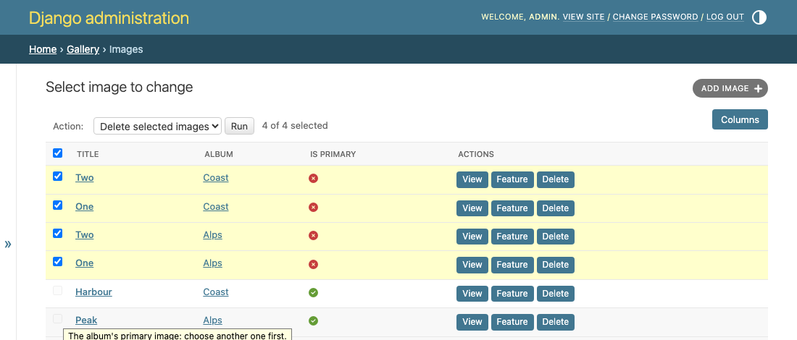

## Search suggestions

The changelist's search box suggests the objects it finds as one types;
choosing one, with the mouse or the keyboard (↑ ↓ Enter, Esc closes), opens
its change page. Enter without choosing one searches as always.

```python
class ImageAdmin(AdminTablesMixin, admin.ModelAdmin):
    search_fields = ("title", "album__title")
    search_suggestions = True
    search_suggestions_limit = 8  # optional (8)
    search_suggestions_min_length = 2  # optional (2)
    search_suggestions_add = True  # optional: nothing found, "+ Add “…”"

    def get_search_suggestion_label(self, request, obj):  # optional
        return f"{obj.title} · {obj.album}"
```

- The suggestions are what the changelist's search finds: its
  `get_search_results()` (`search_fields`, their `^`, `=` and `@`
  prefixes, and whatever overrides it), on `get_queryset(request)`, in the
  changelist's order, each object once.
- What it costs: one query, of `search_suggestions_limit` objects at most,
  a fraction of a second after the typing stops (an older request is
  cancelled). Use `list_select_related` or `get_queryset()` if the label
  reads a relation.
- Only for those who may view or change the objects; each suggestion leads
  to its change page (read-only, for those who may only view it).
  `get_search_suggestion_url()` changes where (None: not suggested), and
  `get_search_suggestions(request, term)` which objects.
- With `search_suggestions_add`, when nothing is found the last option is
  "+ Add “what was typed”": the add page, with it in a field — `True`: the
  first of `search_fields` that is an editable field of the model
  (`"^title"` or `"title__iexact"` count as `title`; none: the add page
  empty), or the field's name (`search_suggestions_add = "title"`). Only
  for those who may add; `get_search_suggestion_add_url(request, term)`
  changes where it leads (None: not offered).
- It looks like the admin's autocomplete fields: Select2's dropdown, on the
  admin's own stylesheets (and Unfold's), light and dark. The search box
  stays a text box: no jQuery, nor Select2's script.
- An accessible combobox (ARIA), without inline scripts (it works under a
  strict Content Security Policy). Not in a popup (where choosing an object
  picks it for a field).

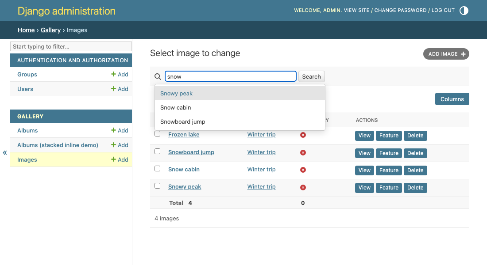

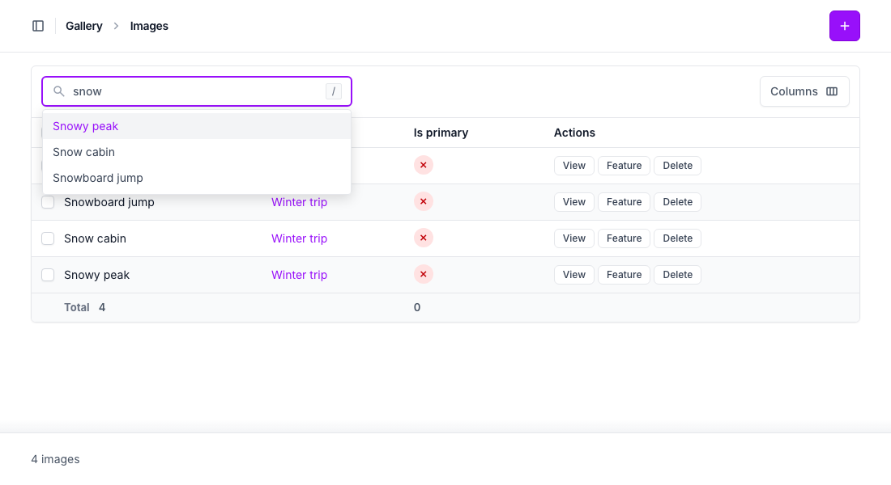

With `search_suggestions_add`, when nothing is found:

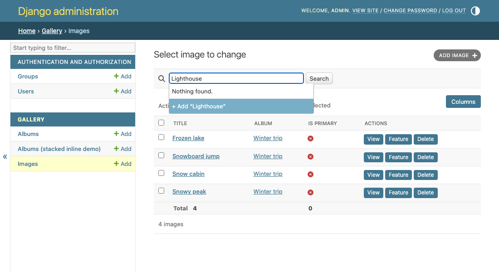

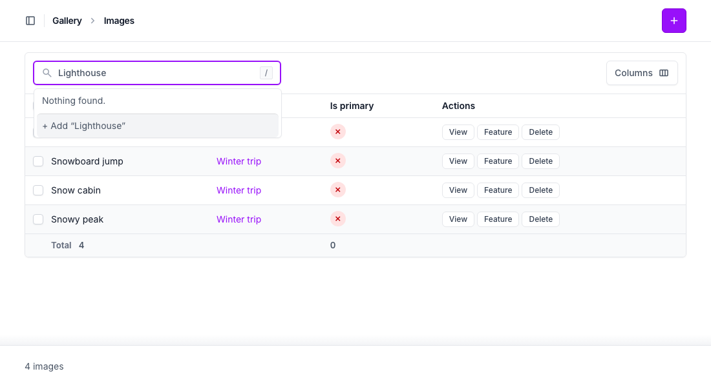

## Autosave

The changelist's `list_editable` fields in `list_editable_autosave` save
themselves as they change, one row and one field at a time — an "active"
switch, a price — without the "Save" button:

```python
class ServiceAdmin(AdminTablesMixin, admin.ModelAdmin):
    list_display = ("name", "price", "active")
    list_editable = ("price", "active")
    list_editable_autosave = ("active",)  # or True: all of them
```

- A switch, a checkbox or a select saves at once; a text, when it's left
  or on Enter (which then doesn't submit the changelist). Its cell says
  "Saving…", "Saved", or why not (read by screen readers too).
- Each save is the changelist's own, for one field: validated by its form
  (`get_changelist_form()`), allowed by `has_change_permission(request,
  obj)`, saved through `save_model()` and `save_related()`, and in the
  object's history. Only that field is sent: nothing else changes.
- If it can't be saved (not valid, not allowed, gone), the field goes back
  to what it was. If someone else changed it since the page loaded, it
  isn't overwritten: it goes back, and says so.
- One request at a time per field; what changes meanwhile goes after it.
- With every `list_editable` field saving itself, the "Save" button isn't
  shown (Django's or Unfold's), and leaving the page asks nothing. With
  some, the button stays for the others, and only they are "unsaved".
- Not for `radio_select_exclusive_fields`: checking one row unchecks
  another, which is the changelist's save.

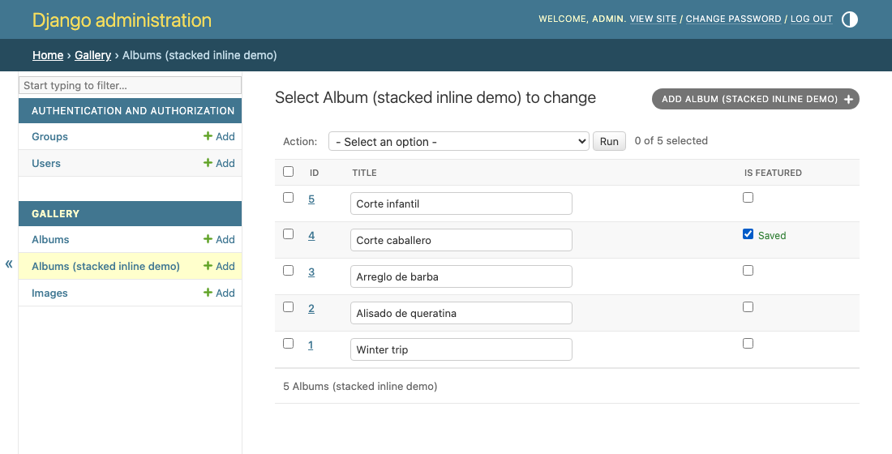

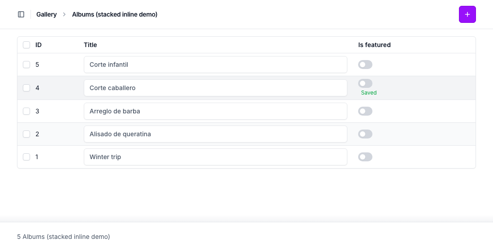

## Unsaved changes

A changelist with `list_editable` asks before its unsaved edits are lost —
by a page link, a filter, sorting, the search, a link elsewhere, the back
button — with the browser's own "Leave site?" prompt. Saving the
changelist, or running an action on it, doesn't ask. After a save with
errors, the values on the page weren't saved: leaving asks then too.

Django's admin only asks before running an action. It's on with
`AdminTablesMixin` (or `UnsavedChangesMixin`) as soon as there's
`list_editable`; `list_editable_unsaved_warning = False` turns it off.

## Content Security Policy

Both the hideable and the responsive columns work under a strict policy,
with no `'unsafe-inline'`: their CSS is set by the package's own script,
`django_admin_tables/columns.js`, as constructed stylesheets (which
`style-src` doesn't restrict), from JSON data blocks (which `script-src`
doesn't run). Serve that script from an origin `script-src` allows, as
the admin's own (`'self'`). Browsers without constructed stylesheets
(before Safari 16.4) get a `<style>` element instead, which such a policy
blocks.

The row actions' buttons have no inline handlers either: their script,
`django_admin_tables/row-actions.js`, is a static file too.

## Themes

- [django-unfold](docs/themes/unfold.md): works as it is, with Unfold's
  radios, checkboxes, buttons and link colors.

## Translations

Ships a Spanish (`es`) translation; its other texts (column headers,
messages) come from Django's own catalogs and your models, so they follow
the admin's language.

## Supported versions

Django 4.2 – 6.1, Python 3.10+.

## Development

See [CONTRIBUTING.md](CONTRIBUTING.md) for setup, running the example
project, and the test/lint/type-check commands.
