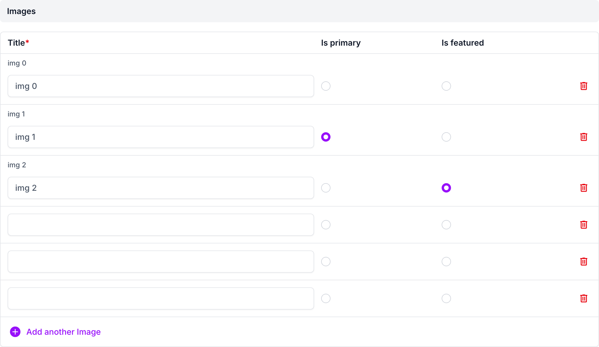
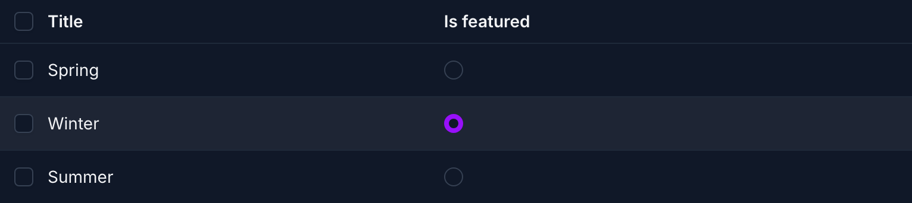
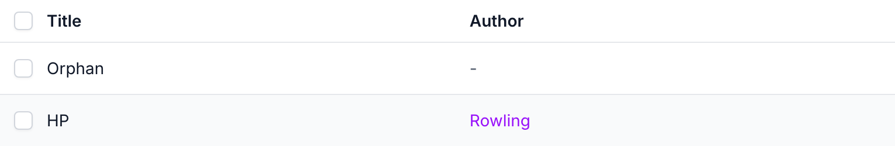
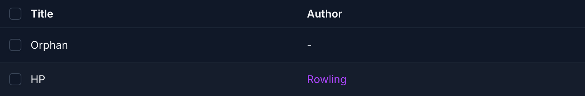
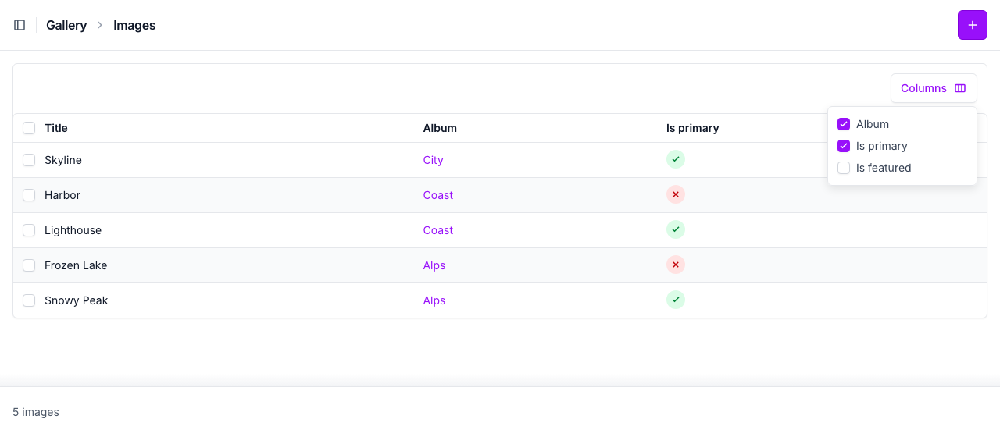
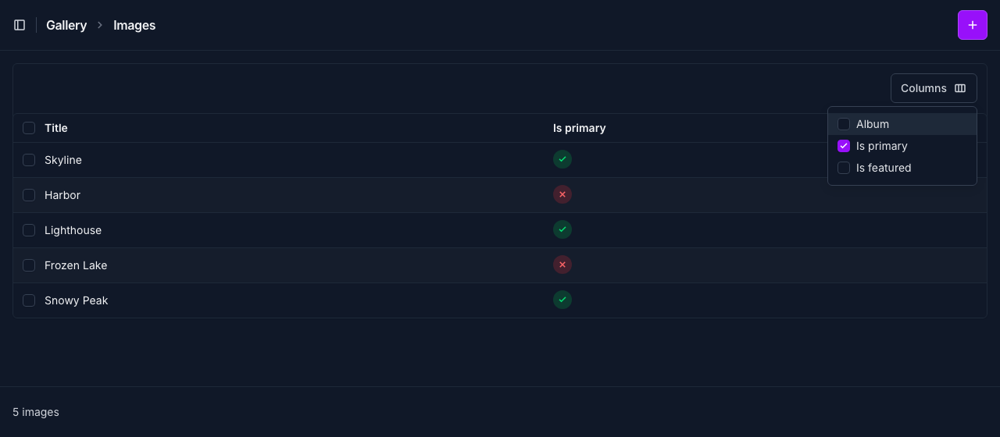
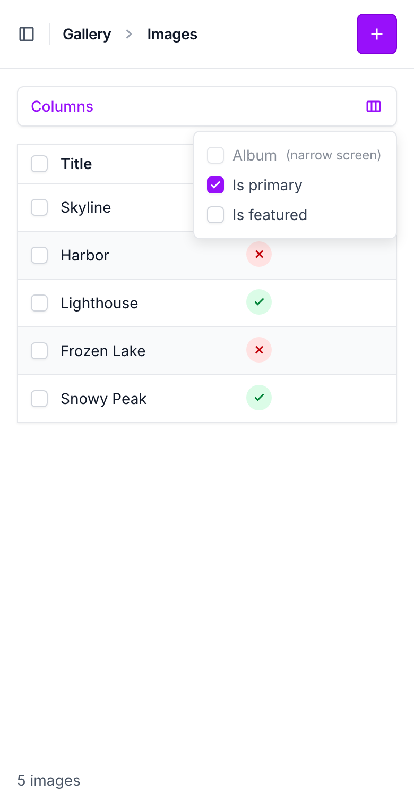

# django-admin-tables with django-unfold

## Usage

Works with [django-unfold](https://unfoldadmin.com/) as it is, on its
`ModelAdmin`, `TabularInline` and `StackedInline`. When `unfold` is in
`INSTALLED_APPS`:

- the exclusive radio fields get Unfold's own radio classes, so they look
  like its other radios;
- the foreign key links get its link colors
  (`text-primary-600 dark:text-primary-500`) — Unfold's reset styles links
  like the text around them. Set `foreign_key_link_class` to use other
  classes, or `""` for none;
- the hideable columns' "Columns" menu sits next to Unfold's "Filters"
  button, styled like it, with Unfold's checkboxes;
- the responsive columns' breakpoints are Unfold's own (Tailwind's `sm`,
  `md`, `lg`, `xl`, `2xl`), and work on its tabular inlines too, which
  Unfold stacks on phones.

Both in light and dark mode. Tested with django-unfold 0.108.

```python
from unfold.admin import ModelAdmin, TabularInline
from django_admin_tables import AdminTablesMixin


class ImageInline(AdminTablesMixin, TabularInline):
    model = Image
    radio_select_exclusive_fields = ("is_primary",)


class ImageAdmin(AdminTablesMixin, ModelAdmin):
    list_display = ("title", "album", "is_featured")
    list_display_foreign_key_links = ("album",)
    list_display_hideable = ("album", "is_featured")
```

## Screenshots

An inline with two exclusive columns:



A `list_editable` column on the changelist, in dark mode:



Foreign key links on a changelist, light and dark:





The "Columns" menu, light, and dark with the album column hidden:





On a phone, with the album column hidden by `responsive_columns`:



## Demo

```bash
cd example
DJANGO_SETTINGS_MODULE=example.settings_unfold python manage.py runserver
```
